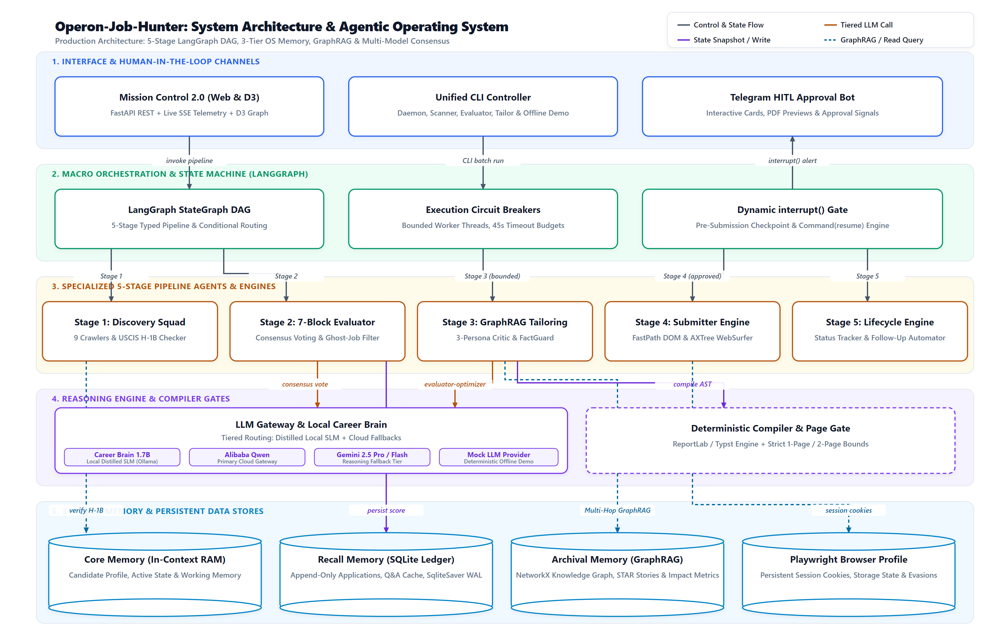

# Operon Job Hunter

[](https://github.com/prasadrane/Operon-Job-Hunter/actions/workflows/ci.yml)

A staged, checkpointed workflow for managing a job search. It finds postings, scores them against a candidate profile, tailors a resume and answers for the ones that qualify, and then **stops for a human decision** before anything is submitted to an employer's application portal.

It is built on LangGraph with SQLite-backed checkpoints, a FastAPI "Mission Control" UI, and Playwright-based form filling. It is a portfolio project: the pieces are real and tested, but it is not a hosted product and it does not run unattended.



## The problem

A job search is a pipeline of repetitive, error-prone steps: triaging postings across many boards, deciding which are worth applying to, rewriting a resume without inventing facts, and filling in near-identical forms. Each step can be assisted by software, but the last one (sending an application under your name) should stay a human decision. This project explores how to structure that as an explicit, resumable workflow instead of a single opaque agent loop.

## Design points

- **Explicit state machine.** Evaluation, tailoring and submission are nodes in a LangGraph `StateGraph` (`src/pipeline/state_machine.py`) with typed state, per-node circuit breakers, and thread-scoped SQLite checkpoints so a run can be inspected and resumed.
- **Human approval before submission.** The graph is compiled with `interrupt_before=["submit_node"]`. A run that passes evaluation and tailoring pauses at `READY_FOR_HITL`; it only continues when a person resumes that job (see [Human approval](#human-approval)).
- **Grounded tailoring.** Resume bullets come from a career knowledge graph built from a `MASTER_RESUME.md`, and a `FactGuard` check rejects claims it cannot trace back to that source.
- **Deterministic fallbacks.** An offline mock LLM provider lets the whole flow run with no API keys, which is what the demo and most tests use.
- **Audit trail.** Agent decisions and browser actions are written to SQLite tables.

## The five stages

| Stage | What it does | Code |
|-------|--------------|------|
| 1. Discovery | Pulls postings from ATS boards (Greenhouse, Lever, Ashby, Workday, SmartRecruiters and others), company career sites, RSS and API feeds (Remotive, Adzuna); canonicalizes and de-duplicates URLs; optional H-1B sponsor lookup against a bundled JSON list. | `src/pipeline/1_discovery/` |
| 2. Evaluation | A 7-block (A-G) rubric covering role summary, skills match, seniority, compensation, pitch angle, STAR story mapping and legitimacy. Includes a ghost-job detector and a work-authorization guard (regex rules, optionally combined with an LLM vote). | `src/pipeline/2_evaluation/` |
| 3. Tailoring | Graph retrieval over the career knowledge graph, evaluator/optimizer passes, `FactGuard`, then PDF rendering (ReportLab, or Typst if installed). Also drafts cover letters and application answers. | `src/pipeline/3_tailoring/` |
| 4. Submission | Tiered form filling: deterministic selector-based autofill with ATS-specific adapters, then an LLM-driven browser agent and an accessibility-tree agent for unfamiliar portals. Supports `--dry-run`. | `src/pipeline/4_submission/` |
| 5. Lifecycle | Library modules for email status classification, online-assessment detection, follow-up drafting, funnel analytics and a retrospective agent. These are not nodes in the LangGraph workflow. | `src/pipeline/5_lifecycle/` |

Stages 2 to 4 are wired into the compiled graph. Stage 1 runs through the scanner (CLI `scan`, the daemon, or the discovery agent), and stage 5 modules are invoked separately.

## Human approval

- The compiled graph pauses before `submit_node`. Both the CLI (`run`) and the multi-agent runtime (`ApplicationAgent`) stop there.
- `python -m src.interface.cli.main mission resume <JOB_ID>` is the explicit step that continues a paused job.
- `AUTO_SUBMIT_ENABLED` defaults to `false`.
- A Telegram approval bot (`src/interface/bot/`) and LinkedIn approval table exist for mobile and outreach approvals. LinkedIn automation is off by default and gated by an approval table and daily caps.

Things to be aware of, because they are deliberate manual escape hatches rather than part of the gated flow:

- `run <JOB_ID> --auto-submit` resumes past the pause in the same command.
- `submit <JOB_ID>` and `POST /api/jobs/{id}/submit` invoke the submitter directly for one job you name. Use `--dry-run` / `dry_run` to avoid a real submission.

## Offline demo

The demo needs no API keys, no browser binaries and no network. It seeds 20 fictional postings for a fictional candidate (Alex Rivera) into a throwaway SQLite database, runs evaluation and tailoring with a deterministic mock LLM, and prints the results.

```bash
pip install -r requirements.txt
python -m src.interface.cli.main demo --jobs 3 --fresh-db
```

Per-job output shows the fit score and whether tailoring produced artifacts (resume PDF, cover letter, markdown under `data/artifacts/<Company>_<job_id>/`). With the mock provider, scores come from a keyword-overlap heuristic, so the demo shows the control flow rather than model quality.

To also exercise submission against the **mock application portal**, an in-process FastAPI app that imitates Greenhouse and Lever forms (`tests/fixtures/mock_ats_server.py`), add `--with-submit`. The submission step runs in dry-run mode:

```bash
python -m src.interface.cli.main demo --jobs 3 --with-submit --fresh-db
```

See [docs/demo.md](docs/demo.md) for details and for the Mission Control UI (`python -m src.interface.cli.main ui`, served at http://localhost:8000).

## Running with real models and your own profile

```bash
cp .env.example .env              # set PRIMARY_LLM_PROVIDER and the matching API key
playwright install chromium       # only needed for real submission
```

Point `PROFILE_DATA_DIR` at a private directory containing your own `MASTER_RESUME.md`; the bundled `data/sample/` profile is fictional. Then:

```bash
python -m src.interface.cli.main scan                  # stage 1
python -m src.interface.cli.main run <JOB_ID>          # stages 2-3, pauses before submit
python -m src.interface.cli.main mission resume <JOB_ID>
python -m src.interface.cli.main status
```

Other commands: `ingest <URL>`, `evaluate`, `tailor`, `submit [--dry-run]`, `daemon`, `ui`, `brain`, `mission`. Run with `--help` for options.

## Running the tests

```bash
pip install -r requirements.txt
python -m pytest tests -q
```

The suite uses the mock LLM provider and a local mock portal, so it needs no API keys or external network. The same command runs in CI (`.github/workflows/ci.yml`). At the time of writing `pytest --collect-only` reports 1,353 tests across `tests/unit`, `tests/integration` and `tests/performance`. Eleven of them assert against the author's private, gitignored career corpus (`data/MASTER_RESUME.md` and `.jsonl`) and are skipped automatically when those files are absent, as in CI or a fresh clone.

## Configuration

Settings are read from environment variables (`src/core/config.py`, template in `.env.example`).

| Variable | Default | Purpose |
|----------|---------|---------|
| `PRIMARY_LLM_PROVIDER` | `alibaba` in code, `mock` in `.env.example` | `mock`, `alibaba`, `gemini` or `openrouter` |
| `MIN_FIT_SCORE` | `72.0` | Threshold used by the multi-agent runtime and API |
| `CHECKPOINTER_DRIVER` | `sqlite` | `sqlite`, `memory` or `postgres` |
| `PDF_COMPILER_BACKEND` | `reportlab` | `reportlab` or `typst` |
| `AUTO_SUBMIT_ENABLED` | `false` | Policy flag; resuming a paused job is still an explicit command |
| `LINKEDIN_ENABLED` | `false` | Opt-in LinkedIn automation |
| `CREDENTIAL_BACKEND` | `keyring` | `keyring`, `env` or `file` |

## Limitations

- **Job-board terms and scraping.** Several crawlers read public career pages, and the JobSpy scraper targets LinkedIn and Indeed. Those sites restrict automated access in their terms of service, and the code does not read or honor `robots.txt`. Applicant tracking systems also change their markup without notice. Review each site's terms before pointing this at it, and keep request volumes low.
- **Form filling is best effort.** Selector-based autofill and the LLM agents will break on portals they have not seen, and CAPTCHA solving depends on a third-party service you configure. Treat every automated submission as something to verify.
- **Work-authorization data is not authoritative.** The bundled `data/h1b_sponsors.json` lists 76 employers with hand-assigned confidence tiers. The dataset manager is written to index DOL/USCIS files, but none ship in the repository. The visa-blocker check is regex rules plus an optional LLM vote over free-text posting language. It will miss and mislabel postings. Do not rely on it for immigration decisions.
- **Two fit thresholds.** The graph's routing step uses a hard-coded score of 85 to decide whether to tailor, while `MIN_FIT_SCORE` (default 72) is used by the multi-agent runtime and API. They should be unified.
- **Submit node reporting.** After resume, `node_submit_and_verify` records a `SUBMITTED` stage and a placeholder `REC-<job_id>` receipt even if the submitter was not invoked or raised an error. Check the submission audit log, not the stage label, to confirm what actually happened.
- **Demo submission step.** In the last run of `demo --with-submit`, the dry-run submission against the mock portal reported `success=False` because the session validator flagged the page as needing login. The portal-level tests in `tests/` (mock ATS fixture) do cover form filling; the demo wiring needs follow-up.
- **Lifecycle tracking is partial.** There is no Gmail integration in the repository. Email classification, OA detection and follow-ups operate on text you give them.
- **Mission Control UI wording.** Some UI text and API docstrings still use "autonomous" language from earlier iterations; the behaviour is the gated workflow described above.
- **Candidate-specific content in tests and fixtures.** Some tests and benchmark fixtures use career details from the author's own history under the "Alex Rivera" persona.
- **Not hardened for multi-user or public hosting.** CORS defaults to `*` in `.env.example` and there is no authentication layer on the API.

## Repository layout

```
src/pipeline/        five stages, state_machine.py (LangGraph), state_schema.py
src/agents/          event-bus agents (discovery, application, networking)
src/brain/           optional local fine-tuned model via Ollama (see docs/brain-usage.md)
src/core/            config, LLM gateway, memory, SQLite repositories, credentials vault
src/interface/       FastAPI + SSE API, CLI, Telegram bot
src/integrations/    read-only ATS board APIs, gated LinkedIn automation
src/demo/            offline demo seeder
web/                 Mission Control front end
tests/               unit, integration, performance; tests/fixtures/mock_ats_server.py
docs/                architecture notes, demo guide, research notes
```

## Further reading

- [ARCHITECTURE.md](ARCHITECTURE.md): contributor reference for the system design
- [docs/demo.md](docs/demo.md): offline demo walkthrough
- [docs/brain-usage.md](docs/brain-usage.md) and [docs/career-brain-training.md](docs/career-brain-training.md): the optional local model

## License

MIT. See [LICENSE](LICENSE).
